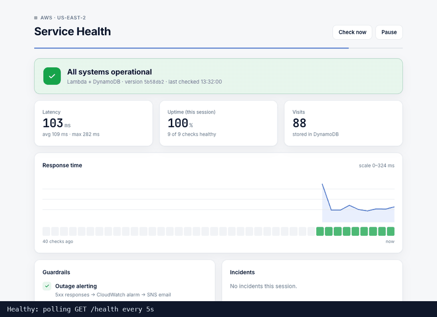
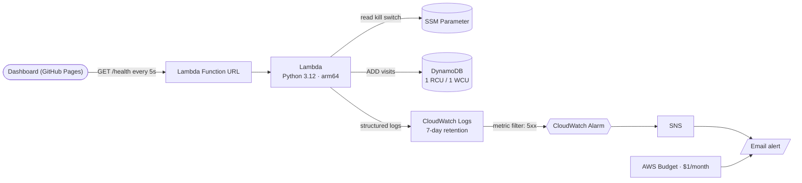
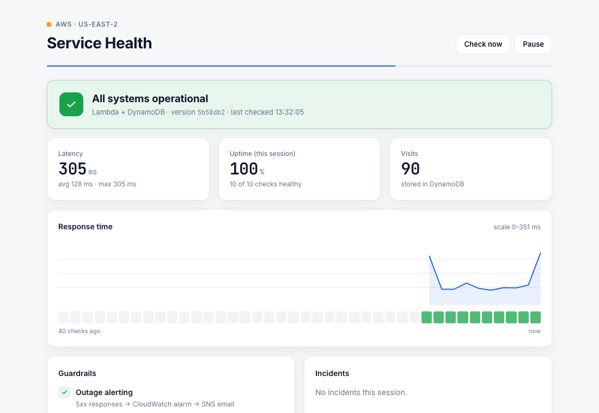
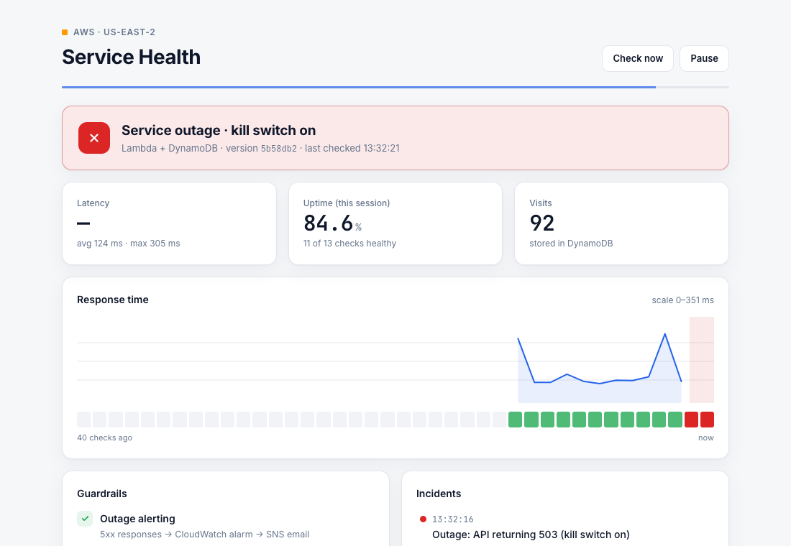

# AWS Service Health

**A serverless AWS service built to be operated, not just deployed:** outage alerting, a kill switch, cost guardrails, and least-privilege IAM, all defined in Terraform.

**[Live dashboard](https://ashokt123.github.io/aws-service-health/)** · [Demo walkthrough](#demo-outage--alarm--recovery) · [Design decisions](#design-decisions)



## Why this project

Most cloud demos stop once the app deploys. Running a service is mostly about the day after: knowing when it breaks, being able to switch it off safely, and making sure it can't run up a bill. This project is a deliberately small API with those operational guardrails built in from the start.

## Architecture



## Guardrails

| Risk | Guardrail |
|---|---|
| Outage goes unnoticed | Every request logs its status as JSON; a metric filter counts 5xx and a CloudWatch alarm emails via SNS |
| Need to take the service down fast | SSM parameter kill switch flips the API to 503 without a deploy |
| Surprise bill | $1/month AWS Budget (actual + forecast alerts); DynamoDB provisioned at 1/1 throttles instead of scaling cost |
| Over-broad permissions | Lambda role can only `UpdateItem` on one table, `GetParameter` on one parameter, and write its own logs |
| Unbounded log storage | 7-day retention on the log group |
| Browser abuse from other sites | CORS limited to the dashboard's origin and `GET` only |
| Configuration drift | Everything in Terraform, tagged `Project` / `ManagedBy` |

## Design decisions

| Decision | Why | Trade-off |
|---|---|---|
| **Lambda Function URL** instead of API Gateway | Free, one resource, enough for a single endpoint | No built-in rate limiting or API keys (see roadmap: CloudFront + WAF) |
| **DynamoDB provisioned 1/1** instead of on-demand | Hard cost ceiling inside the always-free tier | Heavy traffic gets throttled (and shows up as 5xx alerts) |
| **Log-based alarm** instead of Lambda `Errors` | A kill-switch 503 is a *handled* response, so `Errors` stays at 0 | Depends on the log format staying stable |
| **Kill switch cached 5s** in the Lambda | Avoids an SSM call on every request | Switch takes up to ~5s to take effect |
| **arm64 (Graviton)** | Cheaper per GB-second than x86 | None for pure Python |
| **Single Region** (`us-east-2`) | Simple and cheap for a demo | No regional failover (see roadmap) |

## Demo: outage → alarm → recovery

Timings from a real run:

| Step | What happens | Time |
|---|---|---|
| `make outage` | Kill switch on; API returns `503 {"status": "maintenance"}` | ≤ 5s |
| Dashboard | Turns red, uptime drops, incident logged | next poll |
| CloudWatch alarm | `service-health-unhealthy` goes to **ALARM**, SNS emails | ~15–60s |
| `make recover` | API back to 200; dashboard logs "Recovered after Ns"; OK email | ≤ 5s |

| Healthy | Outage |
|---|---|
|  |  |

## Cost

| Service | Free allowance | This project |
|---|---|---|
| Lambda | 1M requests/month | ~720 requests/hour per open dashboard |
| DynamoDB | 25 RCU / 25 WCU | 1 / 1 |
| CloudWatch | 10 alarms, 5 GB logs | 1 alarm, a few MB |
| SNS | 1,000 emails/month | a handful |
| SSM Parameter Store (standard) | free | 1 parameter |
| AWS Budgets | 2 budgets | 1 |
| GitHub Pages | free | dashboard hosting |

Expected cost: **~$0/month**.

## Run it yourself

Prereqs: Terraform ≥ 1.6, AWS CLI v2 with a logged-in profile.

```bash
cp infra/terraform.tfvars.example infra/terraform.tfvars   # set alert_email (and aws_profile if not "multicloud")
make init
make deploy        # plan, then apply (~30s)
make web           # dashboard at http://localhost:8000
make outage        # demo an outage
make recover
make destroy       # tear everything down
```

Confirm the SNS subscription email AWS sends you, or alarm emails won't be delivered.

## Repo layout

```
app/handler.py         Lambda: /health, kill switch, visit counter, structured logs
infra/                 Terraform: Lambda, Function URL, DynamoDB, SSM, IAM, alarm, SNS, budget
web/index.html         Status dashboard (vanilla JS, no build step)
web/config.js          Generated by Terraform: the API endpoint
.github/workflows/     Publishes web/ to GitHub Pages
Makefile               deploy / outage / recover / status / web / destroy
```

## Roadmap

- **CI/CD with OIDC:** GitHub Actions deploys Terraform with short-lived credentials (no stored AWS keys) and remote state with locking
- **Canary deploys:** Lambda alias with weighted routing and automatic rollback on the alarm
- **CloudFront + AWS WAF:** rate limiting and a custom domain in front of the Function URL
- **Synthetic monitoring:** CloudWatch Synthetics so health is checked even when nobody has the dashboard open
- **Azure version:** the same design on Azure Functions + Cosmos DB, deployed from the same Terraform root
